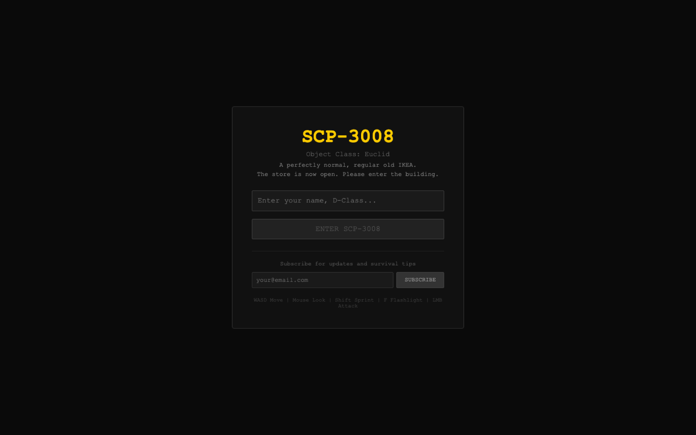

# SCP-3008: The Infinite IKEA

SCP-3008: The Infinite IKEA is a free multiplayer first-person survival horror game that runs in the web browser, for fans of the SCP Foundation and browser horror games.



Live demo: https://scp-3008.vercel.app

It is based on [SCP-3008](https://scp-wiki.wikidot.com/scp-3008), "A Perfectly Normal, Regular Old IKEA."

You are trapped inside an infinite IKEA. During the day, faceless staff wander aimlessly. At night, they become hostile and hunt you down, repeating: *"The store is now closed. Please exit the building."*

## Features

- **Infinite procedural world** — Chunk-based generation creates an endless IKEA interior with living rooms, bedrooms, kitchens, and more
- **SCP-3008-2 entities** — Faceless humanoids with disproportionate bodies (tall/short/normal), yellow shirt and blue pants
- **Day/night cycle** — NPCs are passive during the day, aggressive at night
- **Multiplayer** — Real-time multiplayer via Socket.io
- **Survival mechanics** — Health system, sprint, and death
- **First-person 3D** — Built with Three.js and react-three-fiber
- **Survivor settlements** — Other survivors share dialogue and advice when you reach their camps
- **Weapons and flashlight** — Switch between weapons, attack, and toggle a flashlight
- **Minimap and chat** — A color-coded minimap of store sections and in-game chat
- **Mobile touch controls** — Joystick, drag-to-look and on-screen buttons on phones and tablets

## How it works / Tech stack

- **Frontend:** React, TypeScript, Three.js (react-three-fiber), Zustand, Vite
- **Backend:** Node.js, Express, Socket.io, TypeScript
- **Shared:** TypeScript types between client and server

The client generates the store in chunks around the player (`client/src/utils/worldGen.ts`), renders it with react-three-fiber, and keeps game state in a Zustand store. The server (`server/src/index.ts`) relays player positions, chat and damage between players over Socket.io.

## Getting Started

```bash
npm install
cd client && npm install
cd ../server && npm install
cd ..
npm run dev
```

This starts the game server on port 5002 and the Vite client on `http://localhost:5003`. Open the client in your browser.

Other scripts in the root `package.json`: `npm run build` (builds client and server) and `npm start` (starts the built server).

## Controls

| Key | Action |
|-----|--------|
| WASD | Move |
| Mouse | Look around |
| Shift | Sprint |
| Enter | Open chat |
| Escape | Close chat |
| Click | Lock cursor |
| Left mouse button | Attack |
| 1-4 | Switch weapon |
| F | Toggle flashlight |

## Deployment

The client can be deployed to Vercel. Set the `VITE_SERVER_URL` environment variable to point to your hosted server. `render.yaml` describes the game server as a Render web service (health check at `/health`).

## Project structure

```
client/   React + Three.js game client (Vite)
  src/components/   scene, player, NPCs, HUD, minimap, touch controls
  src/utils/        world generation, networking, audio
server/   Node.js + Express + Socket.io multiplayer server
shared/   TypeScript types used by client and server
```

## License

This project is a fan game based on SCP-3008 by Mortos, licensed under [CC BY-SA 3.0](https://creativecommons.org/licenses/by-sa/3.0/).
